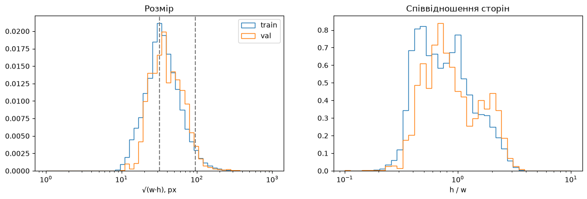
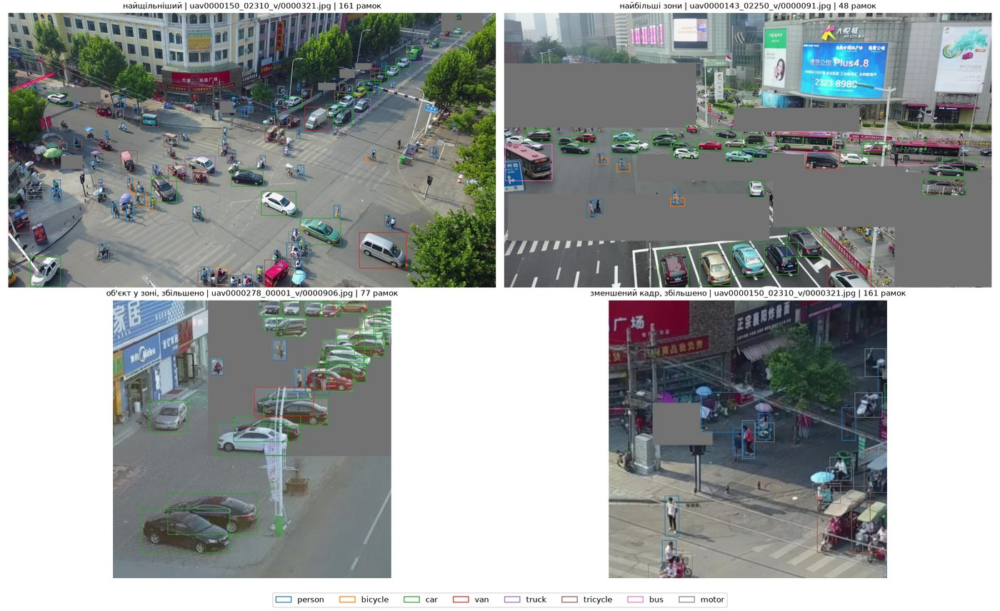
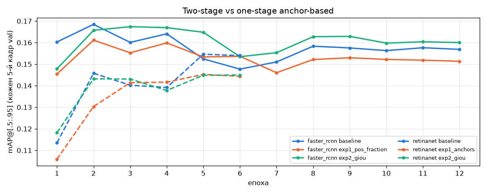
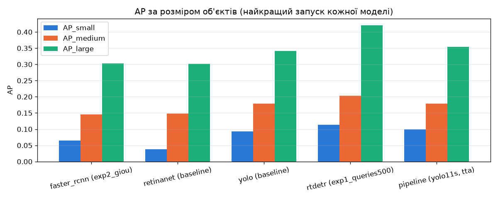
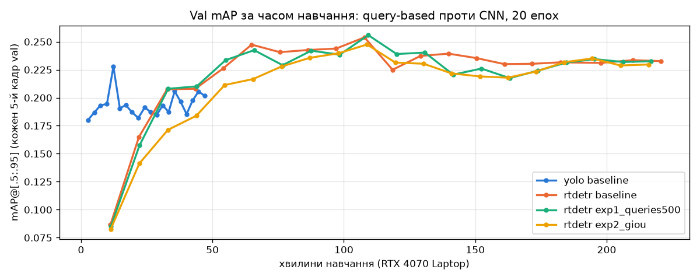

## 1. Дані й валідація

Код: [`01_data.ipynb`](notebooks/01_data.ipynb), оцінювач [`hw2_eval.py`](notebooks/hw2_eval.py).

**Дані**

| | train | val | test |
|---|---|---|---|
| кліпів | 56 | 7 | — |
| кадрів | 24 201 | 2 846 | — |
| об'єктів | 1,1 млн | 114 тис. | — |
| кадрів ширших за 2000 px | 16% | 55% | 0% |

- Дані містять 8 класів: car 46%, person 30%, truck 2,8%, bus 0,9%.
- Розмір: менші за 32×32 px - small 25%, від 32×32 до 96×96 px -  medium 64%,  більші за 96×96 px - large 12%; максимум 180 об'єктів на кадр.
- Тест: усі кадри не ширші за 1920 px, 16% менші за будь-який train-кадр.



**Підготовка train**

- Взято кожен 5-й кадр, всього 4 868 кадрів, бо сусідні кадри майже однакові.
- Ігноровані зони зафарбовано сірим, щоб модель не вчилася на нерозмічених об'єктах як на фоні. Виділені об'єкти в цих зонах відновлено.
- Кадри, ширші за 1920 px, зменшено до 1920, всього 803 кадри. Зменшено, бо в тесті немає 4K-кадрів.
- Val і test без змін.



**Валідація**

- Спліт організаторів за кліпами, спільних кліпів 0; k-fold поділ не робили через обмеження часу.
- Метрика mAP@[.5:.95] (COCO), maxDets 500;  AP50, AP_small/medium/large.
- mAP рахуємо окремо для кожного з 7 val-кліпів, щоб бачити, чи модель виграє через один кліп чи стабільно краща.
- Додатково рахуємо mAP «test-like» на 4 val-кліпах шириною до 1920 px, бо в тесті немає кадрів, ширших за 1920 px. 
- Написали функцію оцінки, яку викликають всі моделі.Рахує всі метрики перелічені вище.Ліміт детекцій моделей 300, бо на кадрі буває до 180 об'єктів.

## 2. Two-stage: Faster R-CNN

Код: [`02_faster_rcnn.ipynb`](notebooks/02_faster_rcnn.ipynb) — один ноутбук, запуск обирає параметр `EXPERIMENT`; аналіз — [`02b_faster_rcnn_analysis.ipynb`](notebooks/02b_faster_rcnn_analysis.ipynb). Навчали на Kaggle.

**Baseline**

- Взяли Faster R-CNN R50-FPN з torchvision з вагами COCO, бо це стандартна two-stage модель: спершу RPN пропонує ділянки, де може бути об'єкт, потім другий етап уточнює рамку і клас.
- Змінили лише роздільність на  960 px і ліміт рамок на 300 замість 100, решта як у torchvision.
- Навчання: 12 епох, batch 4, SGD (learning rate 0,005, momentum 0,9- стандартне , weight decay 1e-4 -стандартне), lr зменшується в 10 разів після 7-ї і 10-ї епох, горизонтальне віддзеркалення, seed 42.
- Batch 4 обрали через обмеження пам'яті GPU на kaggle. Learning rate узяли з офіційного рецепта torchvision 0,02 при batch 16 і зменшили в 4 рази, бо batch у 4 рази менший. Кроки зменшення lr у рецепті стоять після 16-ї і 22-ї з 26 епох, ми пропорційно перенесли їх на 12 епох.

**Експерименти**

| Запуск | Що змінено | mAP | AP50 | AP_small | test-like | Public / Private LB |
|---|---|---|---|---|---|---|
| baseline | — | 0.1565 | 0.3203 | **0.0691** | 0.1717 | — |
| exp1 | частка об'єктів у вибірці 2-го етапу 0,25 → 0,5 | 0.1502 | 0.3102 | 0.0613 | 0.1679 | — |
| exp2 | функція втрат рамок 2-го етапу Smooth L1 → GIoU | **0.1590** | **0.3272** | 0.0647 | **0.1771** | 0.2214 / 0.1524 |

- Exp1 . Другий етап вчиться на 512 пропозиціях на кадр, з яких стандартно лише 25%  це об'єкти, решта беруть  фон. Ми підняли частку об'єктів до 50%, бо на наших кадрах 40–180 об'єктів і ми припускали, що модель краще розрізнятиме класи. Результат гірший за baseline за всіма метриками. Припускаємо це тому що, модель бачила вдвічі менше фону і гірше вчилася його відкидати. Тому експеримент 2 робили зі стандартною часткою 0,25.
- Exp2.  Замінили Smooth L1, яка порівнює координати рамки окремо, на GIoU, яка порівнює, наскільки рамки перекриваються. Тут штраф не залежить від розміру об'єкта, а у датасеті наявно багато дрібних об'єктів. Покращилися mAP, AP50, AP75, AP_medium і test-like, найкращий результат у 5 з 7 val-кліпів. Але AP_small і AP_large трохи впали,  користі для дрібних об'єктів не отримали.

**Аналіз**

- Val mAP найвищий на 2–3-й епосі, а на 12-й нижчий. 12 епох забагато.
- RPN знаходить 98% великих об'єктів і лише 55% малих. Обидва експерименти змінювали тільки другий етап, тому дрібні об'єкти вони покращити не могли.
- Найкраща модель знаходить  приблизно 50% об'єктів: пропускає майже всі об'єкти менші за 16 px і третину більших за 64 px. Найчастіше плутає van і car та bicycle  і motor. AP класу bus ≈ 0, тому що  у val лише 3 автобуси.

## 3. One-stage anchor-based: RetinaNet

Код: аналіз якорів — [`03_retinanet.ipynb`](notebooks/03_retinanet.ipynb), навчання — [`03_retinanet_train.ipynb`](notebooks/03_retinanet_train.ipynb). Навчали на RTX 4070 Laptop.

**Baseline**

- Взяли RetinaNet R50-FPN з torchvision з вагами COCO. Це одноетапна модель: етапу пропозицій немає, рамки й класи передбачаються одразу для всіх якорів приблизно 98 тис. на кадр.
- Через це на кадрі приблизно 270 якорів фону на один якір з об'єктом. Two-stage модель вчиться на вибраних 512 пропозиціях, а RetinaNet бачить усі, тому використовує focal loss, яка зменшує вагу легких прикладів фону.
- Налаштування такі самі, як у Faster R-CNN (960 px, 300 рамок, batch 4, SGD, seed 42), але 6 епох, тому що  Faster R-CNN був найкращим на 2-3-й епосі. Learning rate 0,0025 — рецепт torchvision для RetinaNet.

**Експерименти**


| Запуск | Що змінено | mAP | AP50 | AP75 | AP_small | test-like |
|---|---|---|---|---|---|---|
| baseline | — | **0.1511** | 0.2926 | **0.1434** | 0.0378 | **0.1789** |
| exp1 | розміри якорів ×0,5 (16…406 px замість 32…812) | 0.1432 | **0.3125** | 0.1115 | **0.0519** | 0.1530 |
| exp2 | функція втрат рамок L1 → GIoU | 0.1437 | 0.2848 | 0.1288 | 0.0404 | 0.1650 |

- Exp1. Перед навчанням перевірили на train, скільки об'єктів має хоча б один якір з IoU ≥ 0,5: зі стандартними якорями лише 50%, а об'єкти менші за 16 px взагалі  не накриває жоден. При розмірах ×0,5 покриття 87%, тому взяли його. AP50 і AP_small зросли, отже, модель знаходить більше дрібних об'єктів, але AP75 упав з 0,143 до 0,112: рамки стали менш точними, і загальний mAP нижчий за baseline. Тому експеримент 2 робили зі стандартними якорями.
- Exp2. Як і у попередньому пункті, замінили L1 на GIoU. Тут результат гірший за baseline за такими параметрами: mAP, AP50 і test-like.

**Порівняння з Faster R-CNN**



- Найкращий RetinaNetа саме -  baseline- 0,151, трохи слабший  Faster R-CNN приклад 2 - 0,159, але на дрібних об'єктах набагато слабший.
- RetinaNet швидший  за Faster R-CNN : 28 мс на кадр проти 106 мс, бо в нього немає другого етапу. Але моделі вимірювали на різних GPU (RTX 4070 Laptop і Kaggle T4), тому порівняння приблизне.
- Порівняння не зовсім рівне RetinaNet вчився 6 епох, Faster R-CNN — 12.

## 4. One-stage anchor-free: YOLO11

Код: [`04_yolo.ipynb`](notebooks/04_yolo.ipynb), спільні функції — [`hw2_ultra.py`](notebooks/hw2_ultra.py). Навчали на RTX 4070 Laptop.

**Baseline**

- Взяли YOLO11s з Ultralytics з вагами COCO. Модель anchor-free: якорів немає, кожна точка сітки сама передбачає відстані до країв рамки.
- Розмір s обрали як середнє між якістю і швидкістю для  GPU з 8 ГБ.
- Налаштування: 960 px, 20 епох, batch 8, базові налаштування Ultralytics (оптимізатор `auto`, аугментації mosaic, зміна кольору, віддзеркалення), seed 42.
-  Batch 8 — найбільший, що вміщався в 8 ГБ, 20 епох -  компроміс між якістю і часом навчання.

**Експерименти**

| Запуск | Що змінено | mAP | AP50 | AP_small | test-like | мс/кадр |
|---|---|---|---|---|---|---|
| baseline | — | **0.2002** | 0.3787 | 0.0934 | **0.2322** | **9.7** |
| exp1 | роздільність 960 → 1280 px | 0.1935 | **0.3816** | **0.1252** | 0.2283 | 13.7 |
| exp2 | втрата рамок CIoU → 0,5·CIoU + 0,5·NWD | 0.1683 | 0.3307 | 0.0950 | 0.2072 | 9.6 |

- Exp1. Змінили лише розмір, до якого стискається кадр перед подачею в модель: довша сторона 1280 px замість 960, також batch довелося зменшити до 4 через пам'ять, решта  те саме. Тобто кадр стискається менше, і дрібні об'єкти лишаються більшими. У розділі 1 бачили, що при 1280 px менше 8 px стають лише 0,6% об'єктів, коли при 960 - 1,7%. AP_small виріс з 0,093 до 0,125, але загальний mAP і test-like трохи впали, а модель стала повільнішою на 40%. Тому експеримент 2 робили на 960 px.
- Exp2. Поміняли лост функцію на NWD. Вона порівнює рамки як розмиті плями, тому дає плавний штраф навіть для дрібних рамок, що не перекриваються. Передбачали  покращення на дрібних об'єктах, але AP_small майже не змінився, а mAP упав з 0,200 до 0,168.

**Порівняння з anchor-based моделями**



- YOLO11s найкращий з трьох моделей за всіма розмірами.
- Він же найшвидший — 9,7 мс на кадр у порівнянні з 28 мс у RetinaNet на тому самому GPU.
- Порівняння не зовсім рівне, тому що YOLO вчився 20 епох з сильнішими аугментаціями, а Faster R-CNN і RetinaNet — 12 і 6 епох лише з віддзеркаленням.

## 5. Query-based: RT-DETR

Код: [`05_rtdetr.ipynb`](notebooks/05_rtdetr.ipynb). Навчали на RTX 4070 Laptop.

**Baseline**

- Взяли RT-DETR-L з Ultralytics з вагами COCO. Це трансформер: модель має фіксовану кількість запитів, кожен запит або знаходить один об'єкт, або каже нічого. Під час навчання кожен запит порівнюється з одним об'єктом розмітки, тому дублікатів немає.
- Умови навчання  ті самі, що в YOLO: 960 px, 20 епох, щоб порівняння було чесним.
- Оптимізатор AdamW з learning rate 0,0001 і weight decay 0,0001 — значення зі статті RT-DETR (Zhao et al., 2023).
- Batch 2, через обмеження пам'яті у 8 ГБ.


**Експерименти**

| Запуск | Що змінено | mAP | AP50 | AP_small | test-like | Public / Private LB |
|---|---|---|---|---|---|---|
| baseline | 300 запитів | 0.2385 | 0.4616 | **0.1239** | **0.2509** | **0.3178** / 0.2221 |
| exp1 | 300 → 500 запитів | **0.2433** | **0.4667** | 0.1137 | **0.2509** | 0.3157 / **0.2242** |
| exp2 | вага GIoU у втраті й у зіставленні 2 → 4 (з 500 запитами) | 0.2360 | 0.4604 | 0.1105 | 0.2456 | — |

- Exp1. Модель не може знайти більше об'єктів, ніж має запитів, а на наших кадрах буває до 180 об'єктів, тому збільшили кількість запитів до 500. mAP зріс з 0,239 до 0,243, найбільше на великих об'єктах, але AP_small трохи впав, а test-like не змінився. 

- Exp2.  Змінили баланс у наявній функції втрат: втрата рамок 5·L1 + 2·GIoU стала 5·L1 + 4·GIoU. L1 рахується в координатах від 0 до 1, тому для дрібних рамок вона майже нульова, а GIoU від розміру не залежить. Тому підняли вагу GIoU до 4: очікували, що модель точніше ставитиме рамки на дрібних об'єктах. Результат гірший за exp1 за всіма метриками. 

**Порівняння з YOLO**



- RT-DETR найточніша модель: mAP 0,243 проти 0,200 у YOLO, AP_small 0,114 проти 0,093.
- Але вона значно дорожча на тому самому GPU: навчання ~220 хв проти ~47 хв (майже в 5 разів довше), а передбачення 49 мс на кадр проти 9,7 мс (в 5 разів повільніше).
- На графіку видно, що YOLO досягає свого максимуму - 0,228, вже за ~12 хв, а RT-DETR перевищує цей рівень лише після 55 хв навчання.

## 6. Власний пайплайн

Код: [`06_pipeline.ipynb`](notebooks/06_pipeline.ipynb), функції тайлів і часового перерахунку — [`hw2_ultra.py`](notebooks/hw2_ultra.py). Навчали на RTX 4070 Laptop.

Пайплайн має дві частини, які оцінювали окремо, щоб бачити внесок кожної:

- **A. Інференс** — без перенавчання, на найкращій YOLO11s з розділу 4 (baseline) пробуємо різні способи передбачення.
- **B. Модель** — більша YOLO11m (30 епох, ~140 хв), з тими самими способами передбачення.

Способи передбачення:

- `imgsz+` — на інференсі кадр стискається до 1280 px замість 960, тобто в 1,33 раза більший, ніж при навчанні, щоб дрібні об'єкти стали більшими для моделі.
- `tta` — вбудований у Ultralytics test-time augmentation: модель дивиться на кадр ще й віддзеркалений і в інших масштабах, результати об'єднуються.
- `tiles` — кадр ріжемо на 4 частини 2×2 з перекриттям 20% і подаємо кожну окремо разом із повним кадром, тобто кожна частина ~1,8 раза збільшена. Рамки з усіх частин об'єднуємо через NMS. Спрощена ідея з цієї статті - SAHI (Akyon et al., 2022).
- `temporal` — використовує те, що це відео: оцінка кожної рамки усереднюється з оцінками такої ж рамки на попередньому і наступному кадрі. Рамка, яка є на сусідніх кадрах, зберігає оцінку, а випадкова втрачає. Спрощена ідея  з цієї статті - Seq-NMS (Han et al., 2016).

| Спосіб | YOLO11s mAP | YOLO11s test-like | YOLO11m mAP | YOLO11m test-like |
|---|---|---|---|---|
| base | 0.2002 | 0.2322 | 0.1987 | 0.2080 |
| imgsz+ | 0.1926 | 0.2216 | 0.1962 | 0.2085 |
| tta | 0.2024 | **0.2356** | 0.2008 | 0.2097 |
| tiles | 0.2043 | 0.2305 | **0.2081** | 0.2245 |
| + temporal | 0.1908 (з tta) | 0.2237 | 0.2054 (з tiles) | 0.2224 |

- Найбільше допомогли тайли: AP_small у YOLO11m виріс з 0,106 до 0,120. Але передбачення для YOLO11s у ~7 разів повільніше, бо модель обробляє 5 картинок замість однієї.
- TTA дав невеликий плюс в обох моделях, а збільшення кадру на інференсі — ні.
- Часовий перерахунок погіршив результат в обох моделях. Ймовірно, через те, що дрібні об'єкти часто зникають на сусідніх кадрах, тож правильні рамки теж втрачали оцінку.
- YOLO11m без тайлів не кращий за YOLO11s, а на test-like навіть гірший (0,208 проти 0,232).
- Фінальний варіант обирали за test-like: YOLO11s + TTA (0,2356). YOLO11m + тайли має найкращий mAP, тому його теж відправили на Kaggle ([`06b_second_submission.py`](notebooks/06b_second_submission.py)). На лідерборді: 0,2101 / 0,1671 і 0,2289 / 0,1668 (public / private) — обидва нижче за RT-DETR.

## 7. Зведені результати і висновки

Код: [`07_summary.ipynb`](notebooks/07_summary.ipynb) — читає збережені метрики всіх запусків, нічого не перенавчає.

Найкращий запуск кожної моделі:

| Модель | Запуск | mAP | AP50 | AP_small | test-like | мс/кадр | Public / Private LB |
|---|---|---|---|---|---|---|---|
| Faster R-CNN | exp2 GIoU | 0.1590 | 0.3272 | 0.0647 | 0.1771 | 106* | 0.2214 / 0.1524 |
| RetinaNet | baseline | 0.1511 | 0.2926 | 0.0378 | 0.1789 | 28 | — |
| YOLO11s | baseline | 0.2002 | 0.3787 | 0.0934 | 0.2322 | **9.7** | — |
| RT-DETR-L | exp1, 500 запитів | **0.2433** | **0.4667** | **0.1137** | **0.2509** | 49 | 0.3157 / **0.2242** |
| Пайплайн | YOLO11s + TTA | 0.2024 | 0.3837 | 0.0993 | 0.2356 | — | 0.2101 / 0.1671 |
| Пайплайн | YOLO11m + тайли | 0.2081 | 0.4067 | 0.1195 | 0.2245 | — | 0.2289 / 0.1668 |

 Faster R-CNN виміряно на Kaggle T4, решту — на RTX 4070 Laptop.

- RT-DETR найкраща за всіма метриками, YOLO11s є найшвидша і найкращий компроміс між точності й швидкості.
- Порядок успішноті моделей на private LB збігається з порядком за test-like: mAP Faster R-CNN < пайплайн < RT-DETR. Це підтверджує, що test-like валідна внутрішня оцінка. 
- Найслабше місце всіх моделей це дрібні об'єкти: AP_small у 3–8 разів нижчий за AP_large.
- Для дрібних об'єктів найкраще допомогло збільшити їх на вході на приклад : менші якорі, 1280 px, тайли. AP_small зростав, хоча загальний mAP не завжди. Зміни функції втрат  допомогли лише у Faster R-CNN, а в інших моделях погіршили результат.


## 8. Фінальна модель і запуск

**Фінальна модель — RT-DETR-L експермент1 (500 запитів)**: найкращий val mAP (0,2433), test-like (0,2509) і private LB (0,2242). Власний пайплайн  на 0,04 mAP слабший.

**Середовище.** Python 3.12, GPU з CUDA (ми використовували RTX 4070 Laptop, 8 ГБ). Залежності з точними версіями — [`notebooks/requirements.txt`](notebooks/requirements.txt) (torch 2.5.1, torchvision 0.20.1, ultralytics 8.3.40, faster-coco-eval 1.6.5).

```bash
python -m venv .venv
.venv/bin/pip install -r notebooks/requirements.txt
.venv/bin/python -m ipykernel install --user --name hw2
```

**Дані.** Дані змагання розпакувати в папку `hw2_data/` поруч із репозиторієм (`../hw2_data` відносно кореня):

```bash
kaggle competitions download -c multiple-object-video-detection-hw-2-ucu-ai-2026 -p ../hw2_data
unzip "../hw2_data/*.zip" -d ../hw2_data
```

**Запуск фінальної моделі** (з папки `notebooks/`):

```bash
cd notebooks
../.venv/bin/python -m papermill 01_data.ipynb ../../hw2_runs/01_data.ipynb -k hw2 --cwd .
../.venv/bin/python -m papermill 05_rtdetr.ipynb ../../hw2_runs/rtdetr-exp1.ipynb -k hw2 --cwd . -p EXPERIMENT exp1_queries500
```

1. `01_data.ipynb` готує train-набір
 у `../hw2_prepared/`.
2. `05_rtdetr.ipynb` з `EXPERIMENT=exp1_queries500` навчає модель  і записує `../hw2_runs/rtdetr/exp1_queries500/submission.csv` — це файл, відправлений на Kaggle, а також `metrics.json` з метриками val.

**Усі експерименти.** [`notebooks/run_all.sh`](notebooks/run_all.sh) запускає всі ноутбуки по черзі з потрібним `EXPERIMENT`. Faster R-CNN навчали на Kaggle (T4): той самий [`02_faster_rcnn.ipynb`](notebooks/02_faster_rcnn.ipynb), по одному Kaggle-ноутбуку на запуск (налаштування в `notebooks/kaggle/`). Виконані копії всіх запусків — файли `notebooks/hw2-*.ipynb`.

**Відтворюваність.** Seed 42 скрізь, у Ultralytics ще й `deterministic=True`.
